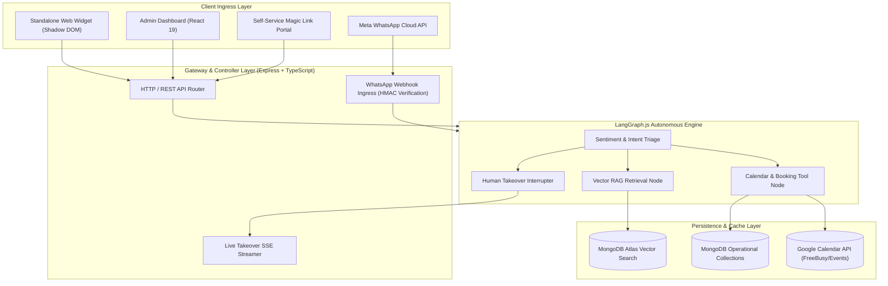
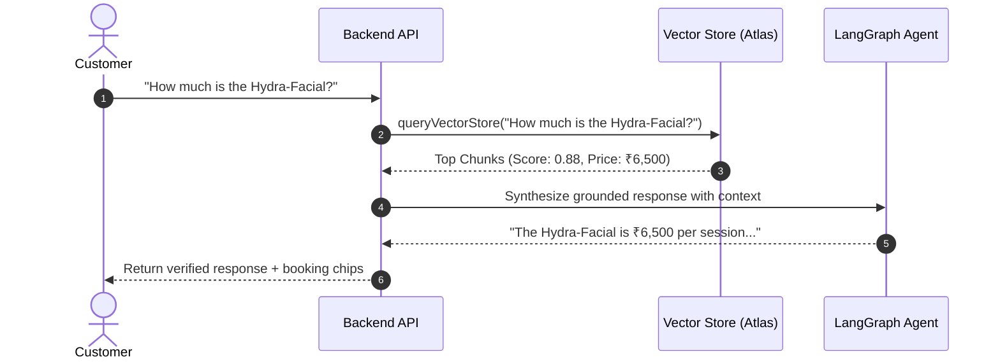

# System Architecture Specification
## OmniAgent: Scalable Multi-Channel Autonomous Agent & Microservices Blueprint

---

## 1. High-Level Architecture Overview

OmniAgent is engineered as a high-throughput, event-driven monorepo containing four decoupled workspaces:
1. `apps/backend`: Node.js, Express, TypeScript, and **LangGraph.js** state machine.
2. `apps/dashboard`: React 19, Vite, Tailwind CSS v4, Lucide Icons, and Google Stitch design system.
3. `apps/widget`: Standalone Shadow DOM embeddable JavaScript bundle (`dist/widget.js`).
4. `packages/shared`: Shared TypeScript types, Zod schemas, and data interfaces.



---

## 2. LangGraph.js Agent State Machine

The core intelligence loop is implemented with `@langchain/langgraph` using a cyclic directed state graph.

### 2.1 State Graph Schema
```typescript
export interface AgentState {
  messages: BaseMessage[];
  customerId: string;
  customerName?: string;
  customerPhone?: string;
  customerEmail?: string;
  sentiment: 'positive' | 'neutral' | 'frustrated' | 'urgent';
  intent: 'knowledge_inquiry' | 'booking_request' | 'reschedule' | 'escalation';
  ragContext?: string;
  confidenceScore?: number;
  isHumanTakeover: boolean;
  selectedSlot?: CalendarSlot;
}
```

### 2.2 Execution Node Pipeline
1. **Triage Node**: Evaluates user sentiment and classifies intent. If sentiment drops to `frustrated` or user explicitly requests a representative, the graph routes immediately to `HITL_NODE`.
2. **RAG Retrieval Node**: Executes semantic search against the Atlas Vector Store, retrieves the top $k=3$ chunks, computes cosine similarity, and formats grounding context.
3. **Calendar Tools Node**: Invokes Google Calendar FreeBusy lookup, verifies slot availability, and commits bookings atomically.
4. **Guardrail Node**: Validates that generated answers are strictly grounded in retrieved chunks, eliminating hallucinations.
5. **Human Interruption Node**: Freezes autonomous graph transitions, flags the session in `activeSessions`, and pushes a high-priority alert to the dashboard.

---

## 3. Vector RAG Subsystem



- **Chunking Strategy**: 500 tokens per chunk with 50-token sliding overlap.
- **Embedding Model**: Text-embedding-3-small (1536 dimensions).
- **Index Specification**: Cosine metric on `$vectorSearch`.
- **Confidence Gate**: Score $\ge 0.50$ triggers grounded response; score $< 0.50$ triggers safe deflection.

---

## 4. Scheduling & Collision Engine
- **Slot Granularity**: 45-minute booking blocks across operating hours.
- **Collision Checking**: Real-time evaluation against active bookings using UTC millisecond comparison (`.getTime()`), preventing race conditions across concurrent booking channels.
- **Status Lifecycle**: `pending_payment` $\rightarrow$ `confirmed` $\rightarrow$ `completed` (or `cancelled`).

---

## 5. Security & Isolation Architecture
- **Stateless Magic-Link Portal**: Encodes `appointmentId` and `timestamp` signed with `HMAC-SHA256`. Requires zero database session lookups and automatically expires after 48 hours.
- **WhatsApp Signature Validation**: All incoming Meta Graph webhooks validated against `X-Hub-Signature-256`.
- **Shadow DOM Isolation**: The embeddable widget encapsulates all styles inside a Shadow Root, guaranteeing immunity from host website CSS leaks.

---

## 6. Document Cross-References
- Product Requirements: [PRD.md](file:///c:/Users/nuruz/Desktop/AI-customer-support-and-booking-agent-for-small-businesses/docs/PRD.md)
- REST API Reference: [API.md](file:///c:/Users/nuruz/Desktop/AI-customer-support-and-booking-agent-for-small-businesses/docs/API.md)
- Database Design: [DATABASE.md](file:///c:/Users/nuruz/Desktop/AI-customer-support-and-booking-agent-for-small-businesses/docs/DATABASE.md)
- Security Model: [AUTH_SECURITY.md](file:///c:/Users/nuruz/Desktop/AI-customer-support-and-booking-agent-for-small-businesses/docs/AUTH_SECURITY.md)
