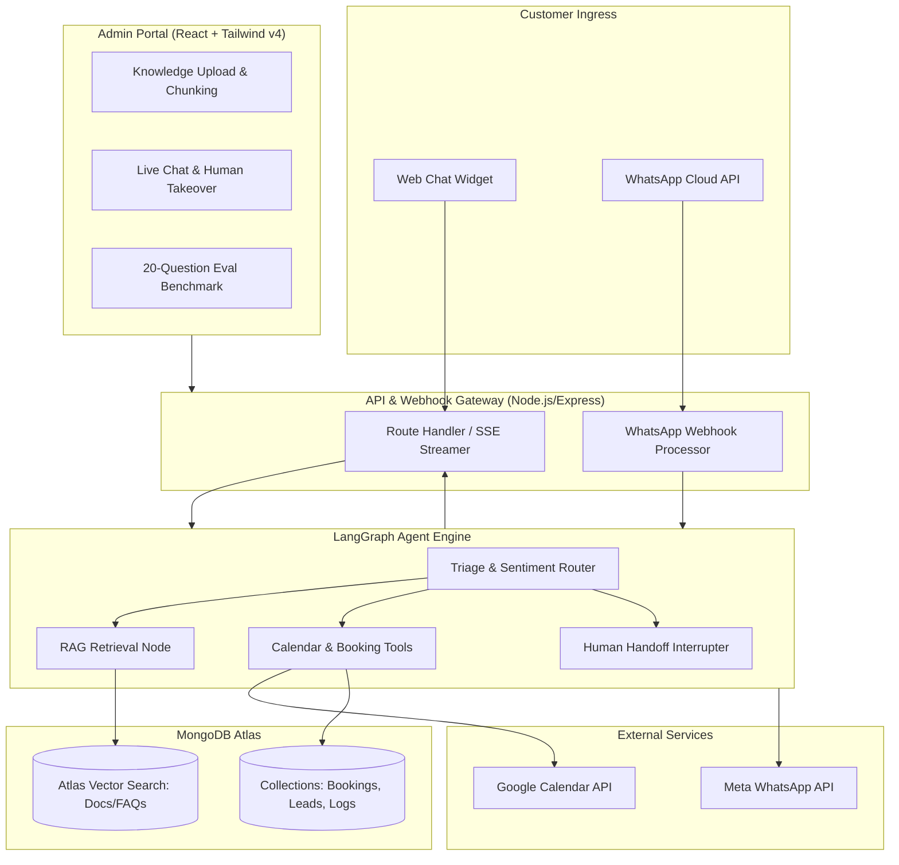

# Implementation Blueprint: AI Customer Support & Booking Agent for Small Businesses

A production-grade, multi-channel AI agent designed for small businesses (clinics, salons, real estate, coaching institutes) that handles RAG-based customer support, calendar appointment booking, lead qualification, and seamless human handoff via both Web and WhatsApp.

---

## 1. Tech Stack Compatibility & Architecture Analysis

| Component | Selected Technology | Why It Fits & Compatibility Assessment |
| :--- | :--- | :--- |
| **Frontend Dashboard** | **React 19 + Vite** | Blazing fast client bundle, zero server cold-starts, ideal for interactive admin operations. |
| **Styling Engine** | **Tailwind CSS v4** | CSS-first configuration (`@import "tailwindcss";`), native lightning-fast Rust compiler, dynamic CSS variable theming for client business white-labeling. |
| **Design Generation** | **Google Stitch MCP** | Generates bespoke, artisanal, production-ready screen prototypes and design tokens. Eliminates the generic "AI-generated template" aesthetic. |
| **Embeddable Widget** | **Vanilla JS / React Shadow DOM** | Lightweight embed script (~25KB) that drops into any WordPress, Shopify, Webflow, or custom site without CSS leakage. |
| **Backend & API** | **Node.js + Express (TypeScript)** | Native JSON handling, streaming SSE support, vast ecosystem for Meta WhatsApp Cloud API and Google APIs. |
| **Agent Framework** | **LangGraph.js** | **Critical Choice**: Unlike basic chain loops, LangGraph provides stateful cyclic graphs with built-in checkpointing, interrupt capabilities (human-in-the-loop takeover), and multi-turn state persistence. |
| **Database & Vector RAG** | **MongoDB Atlas Vector Search** | Unifies operational tables (bookings, leads, chat logs) and vector embeddings under one cluster (`$vectorSearch`). Avoids paying for and synchronizing a separate vector DB. |
| **Integrations** | **Google Calendar API + WhatsApp Cloud API** | Industry standards: FreeBusy slot lookup + calendar event creation; official Meta Graph API webhook for WhatsApp messages. |
| **Evaluation Suite** | **Custom 20-Question Golden Eval Runner** | Ragas / LLM-as-a-judge benchmarking tool answering groundedness, hallucination check, and tool invocation accuracy. |

---

## 2. System Architecture Diagram



---

## 3. Recommended Project Directory Structure

```
ai-customer-support-agent/
├── apps/
│   ├── backend/                      # Node.js + Express + LangGraph.js API
│   │   ├── src/
│   │   │   ├── agent/                # LangGraph state machine & nodes
│   │   │   │   ├── graph.ts          # StateGraph definition & compiled runner
│   │   │   │   ├── state.ts          # Agent state interface
│   │   │   │   ├── nodes/            # Triage, RAG, Booking, Guardrails
│   │   │   │   └── tools/            # gcalTools, leadTools, ticketTools
│   │   │   ├── config/               # Environment & API keys
│   │   │   ├── db/                   # MongoDB client, models & vector indexes
│   │   │   ├── integrations/         # Google Calendar, WhatsApp Cloud API
│   │   │   ├── routes/               # /chat, /documents, /appointments, /whatsapp
│   │   │   ├── services/             # Chunking, Embeddings, RAG retriever
│   │   │   └── evals/                # 20-question benchmark dataset & judge runner
│   │   ├── package.json
│   │   └── tsconfig.json
│   │
│   ├── dashboard/                    # Admin Dashboard (React 19 + Tailwind v4)
│   │   ├── src/
│   │   │   ├── components/           # Bespoke Stitch-designed components
│   │   │   │   ├── appointments/     # Calendar & schedule management
│   │   │   │   ├── knowledge/        # Document dropzone & chunk preview
│   │   │   │   ├── livechat/         # Real-time conversations & takeover switch
│   │   │   │   └── evals/            # Accuracy dashboard & test runner
│   │   │   ├── index.css             # Tailwind v4 theme & custom utilities
│   │   │   └── App.tsx
│   │   ├── package.json
│   │   └── vite.config.ts
│   │
│   └── widget/                       # Embeddable website chat widget
│       ├── src/
│       │   ├── Widget.tsx            # Floating launcher + expandable drawer
│       │   └── index.ts              # Script entry point for external websites
│       └── vite.config.ts
│
├── design-system/                    # Stitch MCP artifacts & design tokens
│   ├── tokens.json
│   └── screens/                      # Exported screen designs from Stitch
├── package.json                      # Workspace root scripts
└── README.md
```

---

## 4. Phase-by-Phase Execution Roadmap & Git Commits

### Phase 1: Project Foundation & Monorepo Setup
- **Goal**: Initialize TypeScript workspace, configure Tailwind CSS v4, establish MongoDB connection, and configure shared types.
- **Deliverables**:
  - Root monorepo configuration with npm/pnpm workspaces.
  - `apps/backend` scaffolded with Express, TypeScript, CORS, and health-check route.
  - `apps/dashboard` scaffolded with Vite, React 19, and Tailwind v4.
  - MongoDB Atlas connection setup with connection pooling.
- **Git Commit**: `feat(core): initialize monorepo with backend, dashboard, tailwind v4 and mongodb config`

---

### Phase 2: Design System & Bespoke UI Prototypes (Stitch MCP)
- **Goal**: Create an artisanal, non-AI-looking aesthetic using Stitch MCP. Generate screens for the Admin Dashboard and Customer Chat Widget.
- **Deliverables**:
  - Call Stitch MCP to establish color palette, typography (e.g. Plus Jakarta Sans or Instrument Sans), dark/light mode tokens.
  - Stitch Screen 1: **Admin Knowledge & Live Control Room** (document ingestion, live chat session with "Human Takeover" toggle, sentiment warning badge).
  - Stitch Screen 2: **Interactive Booking & Evaluation Dashboard** (calendar grid, accuracy score radar, test runner).
  - Stitch Screen 3: **Modern Embeddable Chat Widget** (status indicators, thinking accordion, calendar slot picker carousel).
- **Git Commit**: `feat(design): generate bespoke ui design system and dashboard screens via stitch mcp`

---

### Phase 3: Document Ingestion & Atlas Vector Search RAG
- **Goal**: Enable small businesses to upload PDFs, text policies, and FAQs, auto-chunk them, compute embeddings, and retrieve answers with confidence scoring.
- **Deliverables**:
  - File upload parser (PDF, Markdown, TXT, JSON) with chunking (500 tokens with 50-token overlap).
  - OpenAI / Gemini embedding generator pipeline.
  - MongoDB Atlas Vector Search index configuration (`vectorSearch` index definition).
  - Hybrid RAG retriever with confidence threshold: if similarity score < 0.72, triggers graceful fallback ("I don't have this in my documents; let me connect you with our team").
- **Git Commit**: `feat(rag): implement document chunking, atlas vector search pipeline and fallback threshold`

---

### Phase 4: LangGraph Agent Engine & Multi-Tool Routing
- **Goal**: Build the intelligent LangGraph state machine with cyclic routing, memory, and safety guardrails.
- **Deliverables**:
  - `AgentState` schema: messages, customer context, detected intent, booking draft, sentiment score, humanTakeoverRequired flag.
  - Nodes:
    - **Triage Router**: Categorizes intent into `inquiry`, `booking_request`, `status_check`, or `escalation`.
    - **RAG Node**: Queries Atlas Vector Search for knowledge queries.
    - **Tool Node**: Executes verified business actions.
    - **Sentiment & Guardrail Node**: Detects frustrated customers or out-of-scope prompts and triggers escalation.
  - Live agent thought streaming (emitting tokens: `[Searching knowledge base...]`, `[Checking calendar slots...]`).
- **Git Commit**: `feat(agent): construct langgraph cyclic state machine with triage, guardrails, and streaming`

---

### Phase 5: Calendar Booking & Business Action Tools
- **Goal**: Implement bulletproof calendar slot checking and booking creation with timezone awareness.
- **Deliverables**:
  - `check_availability` tool: Queries Google Calendar `freebusy` API for available slots in the business hours.
  - `book_appointment` tool: Creates Google Calendar event, sends invite to customer email, and writes record to MongoDB `bookings` collection.
  - `capture_lead` tool: Collects customer name, phone, email, and service requirement.
  - Lead / Appointment validation schemas (Zod).
- **Git Commit**: `feat(tools): add google calendar slot verification, appointment creation, and lead capture`

---

### Phase 6: Omnichannel Gateways (WhatsApp Cloud API & Web Widget)
- **Goal**: Connect the agent to real customer communication channels.
- **Deliverables**:
  - **WhatsApp Cloud API Integration**:
    - Webhook verification (`hub.challenge`) and incoming message receiver.
    - Session tracking by WhatsApp Phone Number (`wa_id`).
    - Interactive WhatsApp messages (quick reply buttons for date/time slots).
  - **Embeddable Chat Widget**:
    - Standalone bundle with custom brand colors.
    - Streaming SSE response with real-time tool step visualization.
    - Inline appointment date/time picker inside the chat stream.
- **Git Commit**: `feat(channels): integrate whatsapp cloud api webhook and embeddable web chat widget`

---

### Phase 7: Admin Control Portal & Real-time Live Handoff
- **Goal**: Provide business owners with a sleek dashboard to manage knowledge, watch chats live, and take over anytime.
- **Deliverables**:
  - Document Management screen (drag-and-drop file upload, list of active docs, re-index button).
  - Real-time Chat Monitor via WebSockets / Server-Sent Events.
  - **Human-in-the-Loop Takeover**: One-click toggle to pause the AI agent and allow an agent to chat directly.
  - Appointment calendar view with status indicators (Confirmed, Pending, Cancelled).
- **Git Commit**: `feat(dashboard): build admin knowledge manager, live chat viewer, and human takeover toggle`

---

### Phase 8: Golden Eval Suite (20 Test Questions) & Deployment
- **Goal**: Implement the test suite with 20 real-world business scenarios to measure accuracy, guardrails, and tool calling before production.
- **Deliverables**:
  - 20-Question benchmark dataset covering:
    - 8 Knowledge Base inquiries (pricing, refund policy, opening hours).
    - 5 Booking interactions (valid slot, booked slot collision, out-of-hours).
    - 4 Guardrail & out-of-scope tests (competitor questions, jailbreak attempts, ungrounded questions).
    - 3 Frustration & escalation tests (angry customer, immediate human request).
  - Automated evaluator script computing Groundedness %, Tool Call Accuracy %, and Hallucination Rate %.
  - Deployment configuration for Vercel (dashboard + widget) and Render / Railway (backend API).
- **Git Commit**: `feat(evals): implement 20-question benchmark runner, guardrails test suite and deployment configs`

---

## 5. Verification Checklist

1. [ ] MongoDB Atlas connection and `$vectorSearch` vector index configured.
2. [ ] Tailwind CSS v4 styling configured properly in Vite with zero legacy config file errors.
3. [ ] Stitch MCP screens generated and visual tokens applied to components.
4. [ ] Ingestion pipeline chunks documents and returns grounded answers with citations.
5. [ ] RAG retriever fallback returns "I don't know" when questions fall below threshold.
6. [ ] Google Calendar freebusy check correctly identifies busy vs free slots.
7. [ ] WhatsApp webhook responds to incoming texts within < 3 seconds.
8. [ ] Live chat allows real-time human takeover with agent suspension.
9. [ ] 20-question eval suite runs and outputs measurable accuracy score (>90%).
